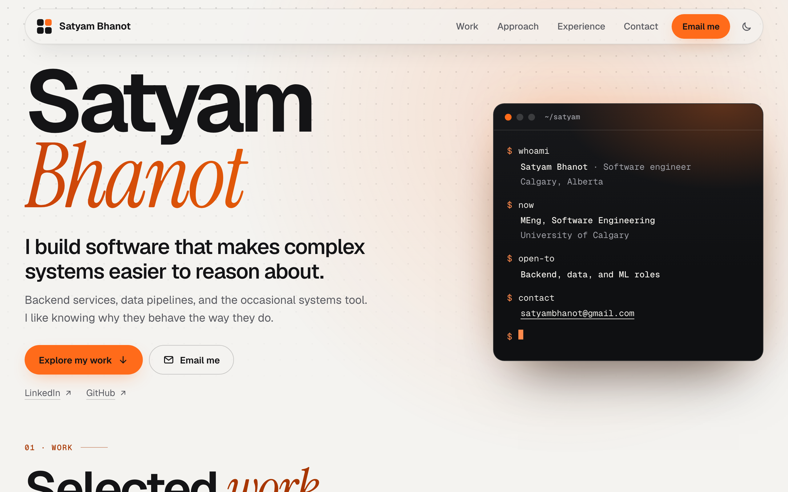

# satyambhanot.com

My personal site: who I am, what I've built, and how to reach me.

**[satyambhanot.com →](https://satyambhanot.com)**

<picture>
  <source media="(prefers-color-scheme: dark)" srcset=".github/screenshot-dark.png">
  
</picture>

## What's on it

- **Intro**: my name, one line on what I build, and a terminal card that types out what I'm
  studying now, what I'm open to, and how to reach me. The first screen leads into the work.
- **Work**: one wide featured project with its headline result and my part, two larger panels,
  then a compact list of everything else. A filter narrows all three by type. Full case studies for
  [Lamplighter](https://satyambhanot.com/projects/lamplighter/) and
  [Where's Waldo?](https://satyambhanot.com/projects/wheres-waldo/)
- **Numbers**: a few results that count up as you scroll, each linked to the project behind it
- **Approach**: habits that show up across the case studies, each linking to where it happened
- **Experience and education**: a timeline that fills as you scroll, plus degrees and tools
- **Contact**: email with a copy button, plus links

It works on phones, in light and dark mode, without JavaScript, and with reduced motion.

## Built with

| | |
| --- | --- |
| Framework | [Astro](https://astro.build) 7, static output |
| Styling | Plain CSS with design tokens; [Geist](https://vercel.com/font), Geist Mono, and [Instrument Serif](https://fonts.google.com/specimen/Instrument+Serif) |
| Content | A TypeScript data file and Markdown, validated at build time |
| Images | Astro's image pipeline: responsive WebP |
| Hosting | GitHub Pages, deployed by GitHub Actions |

There's no UI framework. The only client-side JavaScript is [`src/scripts/site.ts`](src/scripts/site.ts)
(scroll reveals, number count-up, the cursor light, card glow, the project filter, the
case-study comparison and contents highlight, the copy-email button, and the footer clock) and a few lines in the page head for the theme. All of it is an
enhancement: with scripts off, every section is still on the page.

## Run it locally

You need Node 22.12 or newer.

```bash
npm install
npm run dev      # http://localhost:4321, reloads as you edit
npm run build    # static site in dist/
```

## How it's organized

```text
src/
├── site.ts               profile, tagline, numbers, approach, education, experience, tools
├── projects/             one Markdown file per project
├── images/               project screenshots and figures
├── pages/
│   ├── index.astro       the home page
│   ├── projects/[slug].astro   case-study pages
│   └── 404.astro
├── components/           Layout (header + footer), ProjectCard (panels), ProjectRow (compact
│                         list), ProjectArt, Comparison (interactive result), Icon
├── scripts/site.ts       all client-side behaviour
├── styles.css            fonts, then imports the three files below
├── styles/
│   ├── base.css          colours, type, header, footer, buttons
│   ├── home.css          hero, projects, numbers, approach, timeline, contact
│   └── case.css          case-study pages and 404
└── content.config.ts     the fields a project file can have
public/                   favicon, social preview image, CNAME
```

## Updating content

Almost every change is in one of two places. Nothing in the layout needs to change.

**Profile, numbers, education, or experience.** Edit `src/site.ts`. `tagline` is the big line under
my name and `intro` the sentence after it. Lists go newest first, and leaving out an `end` date
marks something as current. The `highlights` list is the row of big
numbers, so only add figures that a project page or your résumé backs up. `principles` are the
four habits in the Approach section.

**A new project.** Add `src/projects/<name>.md`:

```markdown
---
title: My project
summary: One sentence on what it does.
order: 3                  # position on the home page: 1 is featured, 2 and 3 are panels
type: Backend             # picks the card's artwork and its filter button
stack: [Python, FastAPI]
period: Nov 2026          # optional
context: Course or event  # optional
team: Solo                # optional
role: What I built        # optional
highlight: "−25% errors"  # optional, a short result shown as a badge
takeaway: One line on what it taught me.          # optional, shown as a margin note
result:                   # optional, the headline result on the featured panel
  value: "−25%"
  label: errors vs the old pipeline, on held-out data   # keep any qualifier here
repo: https://github.com/satyambhanot/my-project  # optional
---

Optional write-up. If there's text here, the project gets its own page.
```

Projects are shown in three tiers by `order`: the first is the wide featured panel, the next two
are larger panels, and the rest go in the compact "More work" list. A project with only the header
block has no page of its own. Add a write-up below it and it gets a case-study page, and its card
or title links there.
[`lamplighter.md`](src/projects/lamplighter.md) shows a full example with a cover image and
figures. A case study can also carry a `comparison` block (a few options measured on the same
metrics), which becomes the interactive "key result" under the cover image. It either shows each
option's change from a baseline (Lamplighter, from its `results/summary.csv`) or the headline score
itself (Where's Waldo?, from its README), so only put numbers there that the project produced. The card
artwork is drawn from `type` (Backend, Machine learning, Systems, Data, or
Mobile) and the project's name, so a new project gets its own picture without an image. If a
field is missing or a link isn't a valid URL, the build stops and names the file.

**Résumé.** Add `public/resume.pdf` and set `resume: '/resume.pdf'` in `src/site.ts`. Résumé
buttons then appear in the header, the intro, and the contact section.

**Colours.** Every colour is a token at the top of [`src/styles/base.css`](src/styles/base.css),
for light and dark. `--accent` is the orange. If you change it, also update the favicon and the
social preview image in `public/`.

## Deploying

Every push to `main` builds the site and publishes it to GitHub Pages
([workflow](.github/workflows/deploy.yml)). The custom domain comes from `public/CNAME`.

## Design notes

The site is built for someone with a minute to spare, usually a recruiter. It should answer three
questions fast: who is this, what have they built, and how do I reach them. Then it gives the
people who stay something worth exploring.

- **One main page.** It reads top to bottom: intro, projects, numbers, approach, experience,
  contact. The header stays pinned, with the current section highlighted.
- **Evidence first, then depth.** The strongest project gets the most space, with its result and
  the qualifier beside it. Smaller projects get a line each, and the case studies carry the detail:
  title and links, who and what, the picture and key result, then the write-up.
- **Contact in the first screen.** Email, LinkedIn, and GitHub sit next to my name, and the status
  line and terminal card answer the availability question right away.
- **Depth only where it exists.** Case-study pages are only for projects with a real write-up.
  Smaller projects say everything on their card.
- **Honest links and numbers.** Code links appear only where a public repo exists, and every
  figure on the home page comes from a project write-up.
- **A palette of three.** White and warm grey, charcoal, and one orange. Orange is used as light
  (glows, thin lines, small fills), not as large flat blocks. The terminal and contact card stay
  charcoal in both themes.
- **Accessible.** Text passes WCAG AA in both themes (display-size text passes the 3:1 large-text
  bar), orange is only used as text where it is dark enough on that theme, and the site is fully
  keyboard-navigable. Motion respects reduced-motion settings, and content stays visible if
  scripts don't run.

## License

[MIT](LICENSE)
